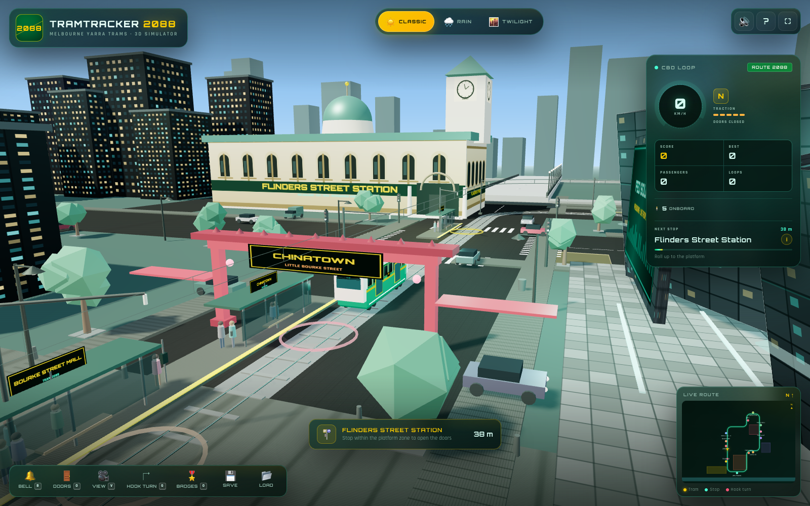
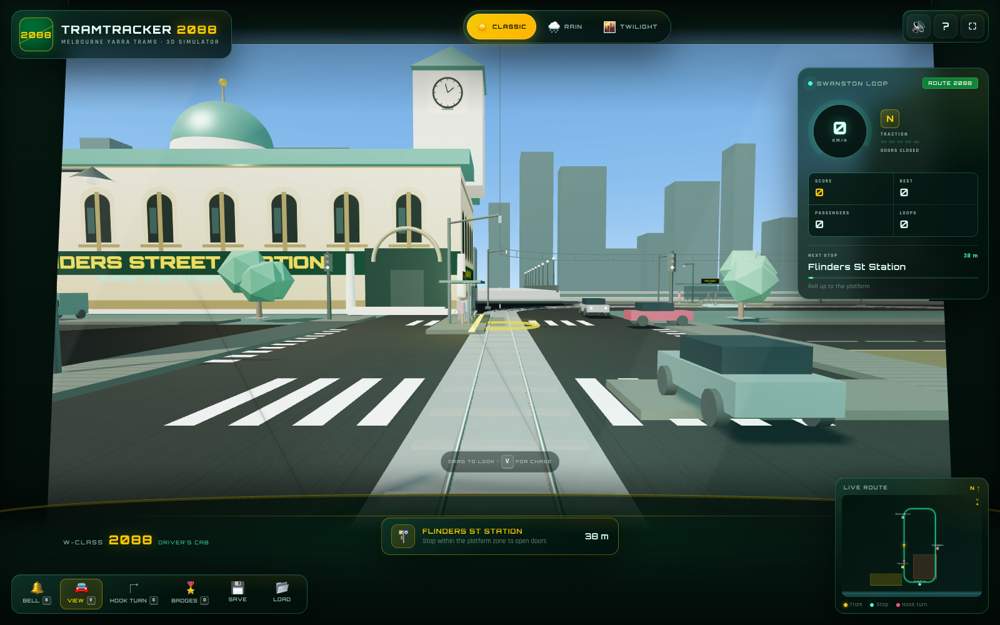
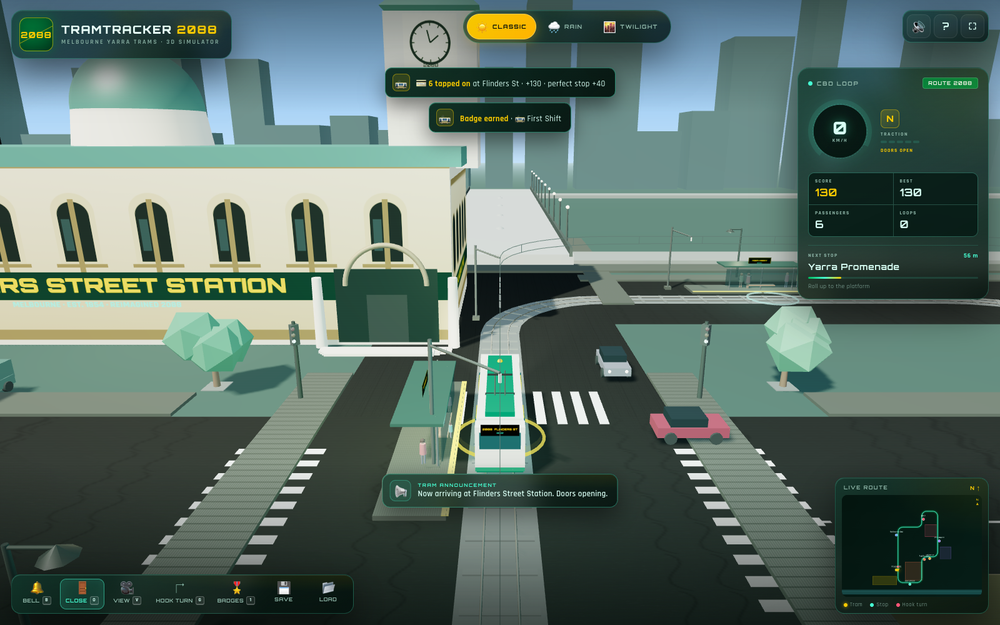
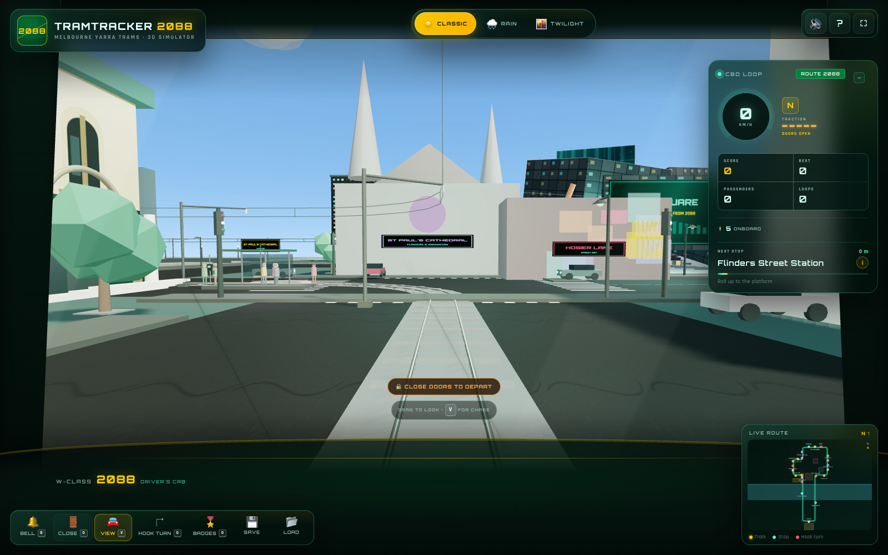
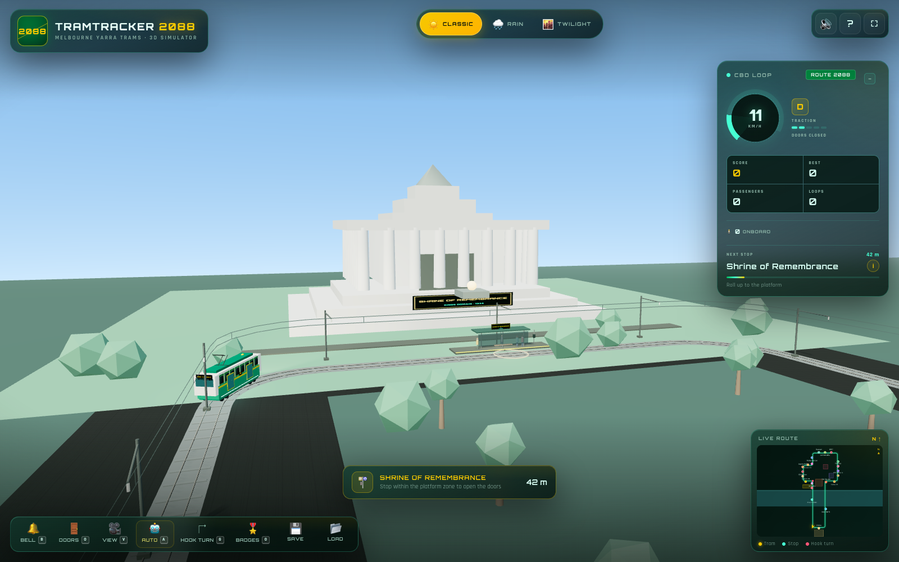
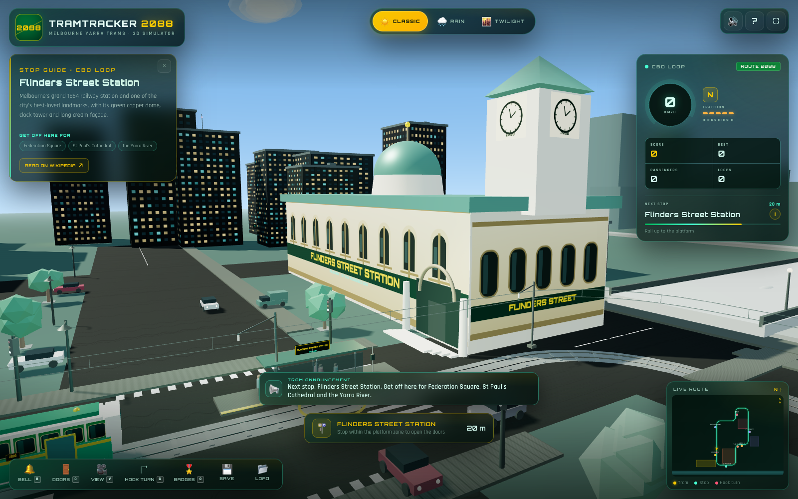
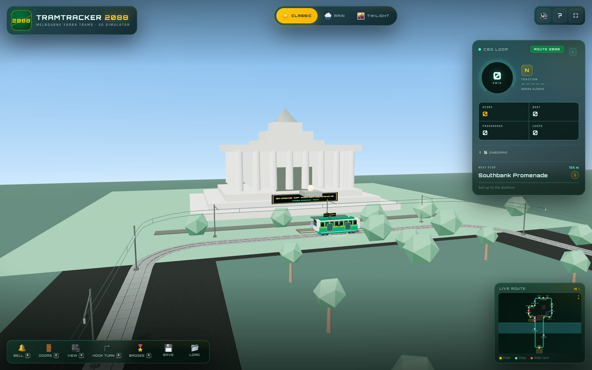
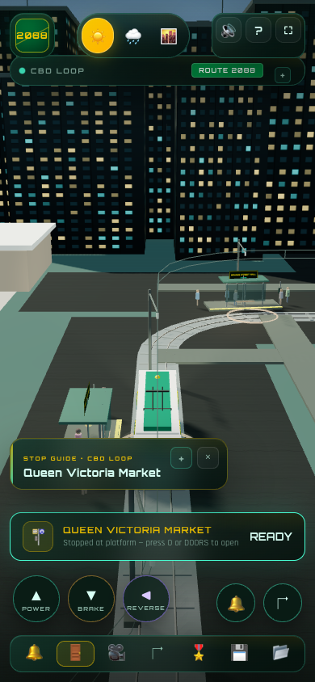
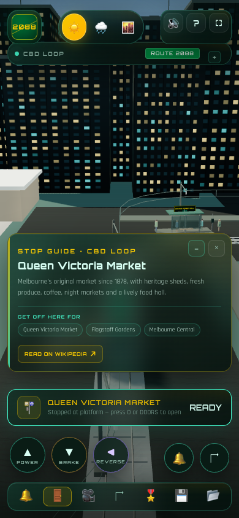
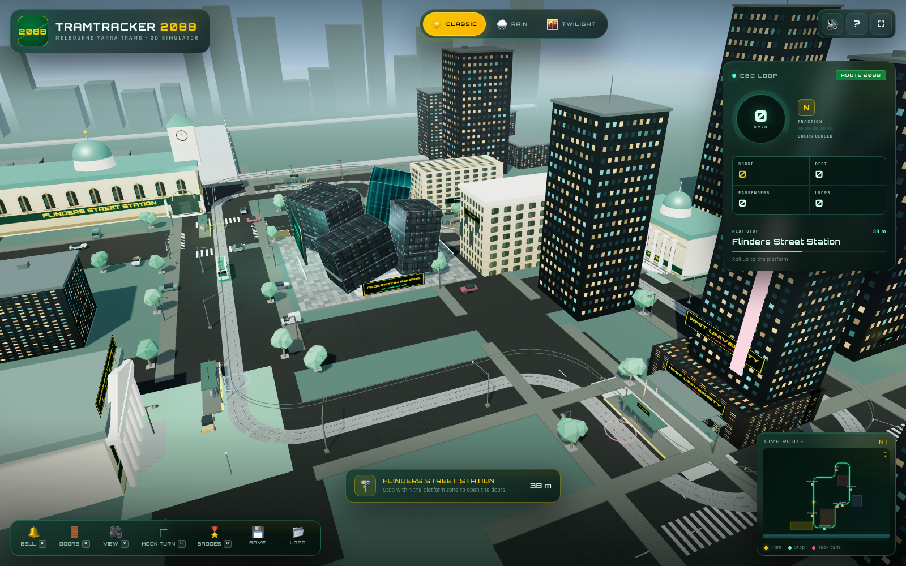

<div align="center">



# TRAMTRACKER 2088

**Melbourne Yarra Trams · 3D Simulator**

Drive a retro-futuristic W-Class cyber tram around an extended Hoddle Grid CBD loop with twenty-one stops, collect Myki passengers, survive four seasons in one day, and master the famous Melbourne hook turn — from the chase camera or the driver's cab.

[](https://somphol.github.io/tramtracker-2088/)
[](#verification)
[](LICENSE)

**[Play it live →](https://somphol.github.io/tramtracker-2088/)**

</div>

---

TramTracker 2088 is a complete, self-contained 3D browser game built with **vanilla HTML5, CSS3 and ES6**, rendered with **Three.js r128** and simulated with **Cannon.js 0.6.2**. There is no build step, no framework and no generated asset bundle: every building, tram, passenger, texture and sound is created in the browser.

The whole thing runs from three files — `index.html`, `style.css` and `script.js`.

<div align="center">

<sub><b>Driver's cab view</b> — press <kbd>V</kbd>, drag to look around, and watch the wipers in the rain.</sub>
</div>

---

## Contents

- [The sim](#the-sim)
- [Doors and announcements](#doors-and-announcements)
- [Door interlock](#door-interlock)
- [Auto driver](#auto-driver)
- [Stop guides and city sound](#stop-guides-and-city-sound)
- [Mobile panels](#mobile-panels)
- [Features](#features)
- [Controls](#controls)
- [The CBD Loop](#the-cbd-loop)
- [Hook Turn Challenge](#hook-turn-challenge)
- [Weather](#weather)
- [Scoring and badges](#scoring-and-badges)
- [Save data](#save-data)
- [Run it locally](#run-it-locally)
- [Project structure](#project-structure)
- [Verification](#verification)
- [Browser support](#browser-support)
- [Credits](#credits)
- [License](#license)

---

## The sim

You clock on at the north end of Swanston Street in a green-and-gold cyber tram. The tram is rail-guided — the computer handles steering, you handle traction and braking. Roll into a platform below 2 km/h, open the doors with `O`, and Myki validators beep as passengers board. The loop now runs out of Swanston into Collins Street, Spring Street, Parliament, RMIT and the northern CBD, following the real Hoddle Grid street pattern.

The extended loop is roughly 1.35 kilometres and carries **twenty-one stops**, taking you past:

- the cream façade, copper dome and clock tower of **Flinders Street Station**;
- the **Arts Precinct**, **Southbank Promenade** and the **Yarra River**, then south down **St Kilda Road**;
- the angular zinc-and-glass shards, plaza screen and amphitheatre of **Federation Square**;
- the Collins Street canyon, the **Old Treasury Building** and the **Parliament of Victoria**;
- **Princess Theatre**, **Fitzroy Gardens**, **Carlton Gardens** and **Melbourne Museum**;
- **RMIT University**, **Queen Victoria Market**, **Melbourne Central** and **Melbourne University**;
- **Bourke Street Mall**, **Chinatown**, **Melbourne Town Hall**, **Hosier Lane** and **St Paul's Cathedral**;
- the **Shrine of Remembrance** in Kings Domain, at the end of the St Kilda Road extension;
- a full cast of low-poly commuters, bikes, taxis, trams, street trees, traffic lights and overhead catenary.

A Cannon.js rigid body follows the rails and collides with street furniture, while the Three.js scene supplies the follow camera, orbit controls and a live HUD.

---

## Doors and announcements



Stopping is now a proper service stop:

- Roll into a platform below 2 km/h. The **Doors** button pulses gold and the stop prompt says to open.
- Press **`O`** (or the toolbar **Doors** button) to release the doors. The 3D door panels slide open, the chime plays and the en-AU voice announces the current stop: *"Now arriving at Flinders Street Station. Doors opening."*
- Passengers tap on with Myki beeps and the score updates.
- Press **`O`** again to close. The warning chime and *"Doors closing. Please stand clear."* play, the doors slide shut, and traction unlocks.
- A subtitle bar displays every announcement, so it still works with sound muted.

Automatic **next stop** announcements call the upcoming platform while you approach, using the browser's Australian English voice, a two-tone chime and the same subtitle strip. The Doors/Myki sound and speech are all synthesised or spoken locally — no audio files.

---

## Door interlock



The tram will not move with the doors open. If you press the throttle while they are still open or closing:

- the speed stays at **0 km/h**;
- a pulsing **🔒 CLOSE THE DOORS BEFORE DEPARTING** bar appears above the toolbar;
- the driver's cab shows **CLOSE DOORS TO DEPART**;
- the close-door warning chime sounds and a toast repeats the instruction.

The warning clears as soon as the doors finish closing. This applies to both the chase camera and the first-person cab.

---

## Auto driver



Press **`A`** or the **AUTO** toolbar button and the driver computer takes the controller:

- accelerates and brakes smoothly along the route;
- slows for each platform and stops inside the zone;
- opens the doors, waits for boarding and alighting, closes them and departs;
- keeps the next-stop announcements, stop requests and guides running.

Any manual throttle, brake or reverse input immediately returns control to you. The **AUTO** button and a cab badge show when the computer is driving.

---

## Stop guides and city sound



As the tram approaches a platform, a **stop guide** slides in with a short history, three nearby places to get off for, and a **Read on Wikipedia** link. Close it and reopen it with the ℹ button beside the next-stop name. Announcements now call the stop and its nearby highlights: *"Next stop, Flinders Street Station. Get off here for Federation Square, St Paul's Cathedral and the Yarra River."*

The city itself is mixed from procedural layers: a low CBD rumble, traffic swells, crowd murmur, birds in the sun, distant tram bells, horns and wind. The bed adapts to the weather and sits under the announcements and bell.

---

## Twenty-one stops from the CBD to the Shrine



The loop now carries **twenty-one stops** and runs for roughly **1.35 km**. The new Shrine extension follows St Kilda Road south across the Yarra and turns around the Domain, so the CBD stops are no longer packed together: the closest pair is still about **30 m** apart.

- **Shrine of Remembrance** — the 1934 war memorial in Kings Domain, at the end of the St Kilda Road extension.
- **Southbank Promenade** — the riverside walk beneath Eureka Tower and beside Southgate.
- **Old Treasury Building** — the 1850s gold-era treasury facing Treasury Gardens.
- **Melbourne Museum** — natural history and First Peoples collections in Carlton Gardens.
- **Queen Victoria Market** — the 1878 market sheds, food hall and night market.
- **Melbourne Central** — the shopping and transport hub built around Coop's Shot Tower.
- **Melbourne Town Hall** — the 1867 civic hall and clock tower on Swanston Street.
- **Hosier Lane** — the ever-changing street-art laneway opposite Federation Square.
- **St Paul's Cathedral** — the Gothic Revival cathedral at Flinders and Swanston.

Together with Princess Theatre, Fitzroy Gardens, Carlton Gardens, Bourke Street Mall and Chinatown, every stop has its own shelter, platform sign, stop guide card, Wikipedia link and announced "get off here for" highlights.

---

## Mobile panels




On a phone the telemetry panel and stop guide can cover a lot of the road. Both now collapse:

- The telemetry header has a **− / +** button that folds the panel down to its title bar.
- The stop guide opens **minimized** on small screens, showing just the stop name and a **+** button; tap it to read the full card and **−** to fold it back.
- On desktop the guide still opens in full, and the same buttons work there too.

---

## Features

### 3D world and tram

- **Swanston Street, Flinders Street and the city grid** built procedurally, with lane markings, zebra crossings, footpaths, street lamps, neon shopfronts and a hook-turn box painted on the asphalt.
- **Two embedded steel rails**, concrete sleepers, a track slab and a full **overhead catenary** with poles, droppers, contact and messenger wires.
- **Flinders Street Station** with a textured arched façade, green copper dome, clock tower, corner entrance and side elevations.
- **Federation Square** with panelled deconstructivist shards, edge neon, a public screen facing Swanston Street, plaza paving, amphitheatre steps and a shard sculpture.
- **Princes Bridge, the Yarra River, Southbank skyline and Melbourne University**, plus around eighty procedurally generated city buildings with lit window textures.
- **W-Class / Cyber-Tram 2088**: green hull, cream roof, gold waistline, window band, destination signs, headlights, tail lights, bogies, pantograph, bell and neon underglow.
- **Rail physics** with acceleration, braking, rolling resistance, curve drag, wheel screech, rail clatter and a Cannon.js tram body for impacts.
- **First-person driver's cab view** with a glass cockpit, dashboard, speed-reactive FOV, head sway and curve lean; drag to look around and let go to ease back to the road. Rain triggers animated wipers and droplets on the glass.
- **Stop guide cards** — approaching each stop raises a background card with nearby landmarks and a Wikipedia link; the ℹ button in the next-stop panel reopens it.
- **Richer city soundscape** — layered low rumble, traffic pass-bys, crowd swells, birds, distant tram bells, horns and wind, mixed by weather.
- **Extended Hoddle Grid CBD loop** — 1.35 km through Swanston, Flinders, St Kilda Road, the Domain, Spring/Exhibition, Victoria Street and La Trobe/Queensberry.
- **Twenty-one-stop tourist loop** — Flinders Street, St Paul's, Hosier Lane, Arts Precinct, Shrine of Remembrance, Southbank, Federation Square, Collins Street, Old Treasury, Parliament, Princess Theatre, Fitzroy Gardens, RMIT, Carlton Gardens, Melbourne Museum, Melbourne University, Melbourne Central, Queen Victoria Market, Bourke Street Mall, Chinatown and Town Hall.
- **Tourist landmarks** — Parliament House, RMIT, the Princess Theatre, Fitzroy and Carlton gardens, the Old Treasury, Melbourne Museum, Queen Victoria Market, Melbourne Central's shot tower, Town Hall, Hosier Lane, St Paul's Cathedral and the Shrine of Remembrance.
- **Door interlock** — traction is blocked with a pulsing warning until the doors are fully closed.
- **Auto driver** — `A` or the AUTO button drives the route, serves every platform, works the doors and departs, with instant manual takeover.
- **Separate brake and reverse** — the brake stops and holds at zero, while reverse is a dedicated `R` / REVERSE control; the brake overrides it.
- **Minimizable mobile panels** — collapse the telemetry and stop guide to see the road.
- Follow camera with **mouse orbit and zoom**, plus a recentre key.

### Passengers and Myki

- Twenty-one named stops with shelters, benches, Myki validators, platform markers and waiting passengers (complete with umbrellas when it rains). Compact 8 m platforms at the dense CBD calls.
- **Manual door release** with `O` or the pulsing **Doors** button once stopped in the platform zone below 2 km/h; the doors slide open, the icon turns cyan and changes to **Close**.
- **Melbourne-style announcements** — a two-tone chime then an en-AU spoken "Next stop…", "Now arriving at… Doors opening" and "Doors closing. Please stand clear", mirrored in an on-screen subtitle bar.
- **Destination manifests** — every passenger who boards is assigned a later stop; the onboard count is shown in the telemetry.
- **Pull-the-cord stop requests** — as a passenger's destination approaches, they request the stop, the cord indicator tugs, a chime sounds and the HUD/cab shows **STOP REQUESTED** until you open the doors.
- **Alighting animations** — when you open the doors, passengers leave the tram, step onto the platform and walk away; boarding passengers then tap on.
- A **synthesised Myki tap-on beep** for each boarding passenger, a staggered boarding animation and a perfect-stop bonus.
- Passenger counts, best score, loops, shift score and career totals update live.

### Hook Turn Challenge

- A separate top-down 3D intersection with Flinders Street tram tracks, live trams, traffic signals, bikes, crosswalks and a painted hook-turn box.
- Drive the car into the box, hold position while the tram clears, then complete the turn across the tracks when the signal goes green.
- Three attempts, a 60-second clock, collision detection for trams and bikes, violations, scoring and a result card.
- Winning awards the **Hook Turn Graduate** badge and adds to your career best.

### Weather

Three instant presets, each changing sky shader, fog, sun colour and intensity, exposure, window glow, street lamps, water colour, rain and stars:

- **☀️ Classic Melbourne Sun**
- **🌧️ Four Seasons in One Day** — rain streaks, wet puddles, thunder and lightning flashes
- **🌆 Twilight Yarra River Glow** — orange horizon, purple fog, stars and brighter neon

### Audio

100% synthesised with the Web Audio API:

- the iconic **double-ding tram bell**;
- **Myki** two-tone validator beeps;
- en-AU stop, arrival and door announcements with a chime;
- wheel screech driven by speed and track curvature;
- **a layered CBD soundscape** — low city rumble, traffic pass-bys, crowd swells, birds in the sun, distant tram bells, occasional car horns and wind;
- rain, thunder, rail clatter, UI clicks, success arpeggio and collision/fail stings.

The city bed follows the weather: birds in classic sun, more wind and rain in a downpour, and a busier neon crowd at twilight. Audio starts on the **CLOCK ON** gesture, as required by browser autoplay policies.

### UI

Yarra Trams green and gold meets a cyberpunk neon HUD: glassmorphic telemetry, conic-gradient speedometer, live route minimap, next-stop guidance, toasts, a driver's manual, route badges, and responsive layouts for desktop, tablet and phone. Touch power/brake/reverse/bell/hook controls appear on small screens.

### Persistence

- Automatic `localStorage` save of best score, total passengers, shifts, loops, distance, hook-turn best, badges, weather and mute state.
- **💾 Save** downloads `tramtracker_save.json`.
- **📂 Load** validates and merges a save file from any device.

---

## Controls

| Action | Keyboard | Touch |
| --- | --- | --- |
| Apply traction | `W` / `↑` | **POWER** pad |
| Brake to a stop | `S` / `↓` | **BRAKE** pad |
| Reverse | `R` | **REVERSE** pad |
| Ring bell | `B` | 🔔 |
| Hook Turn Challenge | `G` | ↱ |
| Open / close doors | `O` | **DOORS** toolbar button |
| Driver / chase view | `V` | **VIEW** toolbar button |
| Auto driver on/off | `A` | **AUTO** toolbar button |
| Recentre camera | `C` | — |
| Mute sound | `M` | speaker button |
| Help | `H` | `?` button |
| Fullscreen | `F` | ⛶ button |
| Orbit / zoom camera | drag / wheel | drag / pinch |
| Look around the cab | drag | drag |

In the Hook Turn Challenge: `W`/`↑` throttle, `S`/`↓` brake, `A`/`D` or `←`/`→` steer.

---

## The CBD Loop



The route is modelled on Melbourne's [Hoddle Grid](https://en.wikipedia.org/wiki/Hoddle_Grid): Flinders, Collins and La Trobe run east–west, while Swanston and Spring/Exhibition run north–south. All twenty-one stop names follow the real Melbourne tram network and the landmarks around them.

| # | Stop | Where it is | Platform detail |
| --- | --- | --- | --- |
| 1 | **Flinders Street Station** | Flinders St, west of Swanston | Shelter, bench, Myki validator |
| 2 | **St Paul's Cathedral** | Flinders and Swanston | Compact heritage platform |
| 3 | **Hosier Lane** | St Kilda Road approach, by the lane | Compact laneway platform |
| 4 | **Arts Precinct** | St Kilda Road, by the Arts Centre | River-facing shelter |
| 5 | **Shrine of Remembrance** | St Kilda Road, Kings Domain | Domain forecourt platform |
| 6 | **Southbank Promenade** | Domain return boulevard, by the Yarra | Riverside shelter |
| 7 | **Federation Square** | Flinders St, east of Swanston | Plaza-side shelter |
| 8 | **Collins Street** | Collins St East, by the Paris End | Compact Paris-end platform |
| 9 | **Old Treasury Building** | Spring St, by Treasury Gardens | Compact heritage platform |
| 10 | **Parliament** | Spring Street, by Parliament House | Compact Parliament platform |
| 11 | **Princess Theatre** | Spring Street, by the theatre | Compact theatre platform |
| 12 | **Fitzroy Gardens** | Spring Street, by the gardens | Compact garden platform |
| 13 | **RMIT University** | Victoria Street, by the campus | Campus-side shelter |
| 14 | **Carlton Gardens** | Victoria Street, by the Exhibition Building | Garden-side shelter |
| 15 | **Melbourne Museum** | Victoria Street, by the museum | Museum-side shelter |
| 16 | **Melbourne University** | Swanston St, by the Parkville campus | University-side shelter |
| 17 | **Melbourne Central** | Swanston St, by the shot tower | Compact CBD platform |
| 18 | **Queen Victoria Market** | La Trobe St, by the market | Compact market platform |
| 19 | **Bourke Street Mall** | Queen St, at Bourke | Compact mall platform |
| 20 | **Chinatown** | Queen St, at Little Bourke | Compact laneway platform |
| 21 | **Melbourne Town Hall** | Queen St, by the Town Hall | Compact civic platform |

The route follows the Hoddle Grid’s parallel streets: Flinders, Collins and La Trobe run east–west, while Swanston, Spring/Exhibition and the northern edge close the loop. Stops are placed by arc length on the closed Catmull-Rom loop, so the next-stop HUD and minimap always agree with the rails.

---

## Hook Turn Challenge

Melbourne's hook turn lets a right-turning car wait on the far side of the intersection instead of blocking the tram tracks. The mini-game distils that into a 60-second challenge:

1. **Enter the box** — drive east and stop inside the yellow hook-turn box.
2. **Wait for the tram** — hold position. The signal stays red while a tram is crossing.
3. **Turn on green** — once the tram clears, the signal turns green for a short window. Cross the tracks and reach the cyan target ring.

Hitting a tram or bike costs an attempt. Crossing early is a violation. Three attempts, one badge, and a score based on time remaining.

---

## Weather

The three presets are selected from the top bar. Each one is applied instantly by interpolating the sky shader, fog, sun, hemisphere light, ambient light, exposure, window emissive maps, street lamps, puddles, rain opacity, water colour and star opacity.

Rain also schedules thunder and a subtle lightning flash every 8–18 seconds.

---

## Scoring and badges

| Action | Score |
| --- | ---: |
| Passenger tapped on | 15 each |
| Perfect stop (within 4.2 m of the marker) | +40 |
| Complete a full loop | +250 |
| Win the Hook Turn Challenge | 120–1,400 (time and violations) |

Nine route badges are stored in your career:

🚋 First Shift · 💳 Myki Rookie · 🎫 Commuter Legend · 🔁 City Loop · 🛤️ Swanston Regular · ↱ Hook Turn Graduate · 🌧️ Four Seasons Driver · 🌆 Yarra Glow · 🏆 2088 Legend

---

## Save data

`localStorage` key: `tramtracker_2088_v1`

Exported file: **`tramtracker_save.json`**

```json
{
  "app": "TramTracker 2088",
  "version": 1,
  "stats": {
    "bestScore": 0,
    "totalPassengers": 0,
    "trips": 0,
    "loops": 0,
    "totalDistance": 0,
    "hookBest": 0,
    "hookWins": 0,
    "rainDistance": 0
  },
  "badges": [],
  "settings": { "weather": "sunny", "muted": false },
  "exportedAt": "2026-11-01T00:00:00.000Z",
  "credits": "Built with OpenCode + DeepSeek V4.1 Flash"
}
```

Imports are schema-validated: unknown badges are discarded, numbers are clamped, and career values are merged with `max()` rather than overwritten. Invalid JSON is rejected with a toast.

---

## Run it locally

No install and no build step:

```bash
# from the project folder
python3 -m http.server 8080
# open http://localhost:8080
```

Opening `index.html` directly also works, but a small local server is recommended for consistent module/network behaviour.

Internet access is required for the Three.js and Cannon.js CDNs and the Google Fonts. The app falls back gracefully with a clear error message if Three.js or Cannon.js cannot load.

### Self-test surface

Append `?selftest=1` (optionally with `&autostart=1`) to run the built-in 29-check harness. Results are written to `#selftestOut`, `document.body.dataset.selftest` and the console.

Useful development params:

- `?autostart=1` — skip the start card
- `?weather=rain|twilight|sunny` — start in a weather preset
- `?fresh=1` — clear the local save on load
- `?shot=1` — hide loading/start overlays for screenshots
- `?view=station|fed|tram|yarra|uni` — fixed screenshot views

---

## Project structure

```text
tramtracker-2088/
├── index.html                    # HUD, overlays, dialogs, CDN scripts
├── style.css                     # Yarra green/gold + neon glass design system
├── script.js                     # world, physics, gameplay, audio, hook turn
├── screenshot.png                # hero screenshot
├── screenshot-rain.png
├── screenshot-twilight.png
├── screenshot-station.png
├── screenshot-fedsquare.png
├── screenshot-university.png
├── screenshot-yarra.png
├── screenshot-hook.png
├── screenshot-mobile.png
├── screenshot-start.png
├── screenshot-stop-guide.png
├── screenshot-stop-request.png
├── screenshot-door-warning.png
├── screenshot-auto.png
├── screenshot-mobile-guide.png
├── screenshot-shrine.png
├── screenshot-qvm.png
├── screenshot-southbank.png
├── screenshot-bourke.png
├── screenshot-chinatown.png
├── screenshot-princess.png
├── screenshot-tour.png
├── screenshot-driver.png
├── screenshot-driver-rain.png
├── screenshot-doors.png
├── screenshot-cbd.png
├── screenshot-collins.png
├── screenshot-parliament.png
├── screenshot-rmit.png
├── STATE.md / state.json         # build duration, token usage, credits
├── THIRD_PARTY_NOTICES.md
├── LICENSE
└── .nojekyll                     # GitHub Pages
```

Build duration, token usage and full credits are recorded in [STATE.md](STATE.md) and [state.json](state.json).

`script.js` is organised into small classes and sections:

- `TramApp` — scene bootstrap, world construction, driving, boarding, weather, HUD and persistence;
- `HookTurnGame` — the separate mini-game renderer and state machine;
- `AudioEngine` — every synthesised sound;
- save/sanitise helpers and the badge/route/weather data tables.

---

## Verification

The built-in harness reports **33/33 PASS**, covering:

- Three.js r128 and Cannon.js 0.6.2 runtime availability;
- WebGL renderer, 400+ object scene and the 1.35 km twenty-one-stop CBD loop;
- twenty-one named stops, a minimum 30 m spacing check, tourist landmarks and waiting passengers;
- tram mesh, 12,000 kg Cannon body, catenary, station, Federation Square and Yarra geometry;
- Web Audio voices and three weather presets;
- save schema validation and the export/import path;
- nine badges, minimap, HUD and save/load UI wiring;
- a live traction simulation that moves the tram;
- a live Myki boarding simulation that adds passengers and score;
- weather switching;
- hook-turn scene readiness;
- driver's cab view switching, FOV and orbit-control handoff;
- manual door open/close, boarding and announcement wiring;
- the 1.35 km twenty-one-stop loop and the Parliament/RMIT/Princess/Fitzroy/Carlton/Old Treasury/Museum/Queen Vic/Melbourne Central/Town Hall/Hosier/St Paul's/Shrine landmarks;
- stop-guide cards, nearby places and Wikipedia links;
- passenger destination manifests, stop requests and alighting animations;
- the door interlock warning and the minimizable telemetry/stop-guide panels;
- the auto driver approaching, serving a platform, working the doors and departing;
- the layered city ambience and Thai-style stop announcements;
- zero uncaught errors.

Headless Chrome (SwiftShader WebGL) screenshots were used to verify desktop 1600×1000 and mobile 390×844 layouts, all three weather presets, the hook-turn challenge, and the start/result overlays.

---

## Browser support

Built and tested in current Chrome/Chromium with WebGL 1/2. It uses standard ES6, Canvas 2D, Web Audio and `localStorage`. For best results use a recent desktop browser with hardware acceleration; mobile works with the on-screen touch controls.

---

## Credits

Created in a single agent session with **[OpenCode](https://opencode.ai) v2.2.5** and **DeepSeek V4.1 Flash** (`opencode-go/deepseek-v4.1-flash`).

Runtime libraries:

- [Three.js](https://threejs.org/) r128 — MIT
- [Cannon.js](https://schteppe.github.io/cannon.js/) 0.6.2 — MIT
- **Orbitron** and **Rajdhani** via Google Fonts — SIL Open Font License 1.1

No external image, texture, audio or 3D-model assets are used. The city, station, Federation Square, university, river, tram, passengers, textures and every sound are generated procedurally.

See [THIRD_PARTY_NOTICES.md](THIRD_PARTY_NOTICES.md) for full notices.

---

## License

[MIT](LICENSE) © 2026 Somphol Boonjing
